# Hotspot Collection Network（热点采集网络）

单人本机的跨境热点采集与线索加工工具。本仓库当前为 **T2 项目骨架**：一条命令起服务，接上配置层与 SQLite 八张表，提供健康检查接口。采集（T3）、LLM 加工（T4/T5）、大屏（T7）尚未实现。

## 一、安装

1. 安装 **Python 3.11 或更高**（安装时勾选 **Add Python to PATH**）。
2. 在项目根目录执行：

   ```bash
   pip install -r requirements.txt
   ```

3. （可选但强烈建议）配置密钥：把 `.env.example` 复制为 `.env`，填入 `DEEPSEEK_API_KEY`（获取地址：https://platform.deepseek.com → API Keys）。不填也能启动，只是页面会提示去申请，模型功能暂不可用。

### 国内网络安装提示

直连 PyPI 常出现 `SSL: UNEXPECTED_EOF_WHILE_READING`，换国内镜像即可：

```bash
pip install -r requirements.txt -i https://pypi.tuna.tsinghua.edu.cn/simple
```

> 已在干净目录 + 全新 venv 环境实测：装完依赖后 `python run.py` 可直接启动，
> 自动建 8 张表、拉起 RSS 桥、无 API Key 时页面提示申请而不报错（2026-10-21）。

## 二、启动

**双击桌面「热点采集网络-启动」** 即可：先弹一个选择框问你要打开哪个页面，然后后台静默运行（不出现命令行窗口），浏览器打开所选页面。

| 选项 | 打开的页面 |
|---|---|
| 1（默认，直接回车） | 大屏（3D 地球 + 线索） |
| 2 | 设置（数据源 / 模型 / 代理 / 体检） |
| 3 | 成本与预算 |
| 4 | 备忘录 / 收藏 |
| 5 | 只启动，不打开网页 |
| 0 | 取消启动 |
所有运行日志写到 `data/logs/app.log`（uvicorn 的逐请求日志已关闭，文件不会刷屏）。
需要看日志：`Get-Content data\logs\app.log -Tail 50`。

停止：双击「热点采集网络-停止」。


```bash
python run.py
```

- 启动时会依次检查：Python 版本、依赖、端口（默认 9000）、数据库。
- 成功后在浏览器打开 <http://127.0.0.1:9000>（首页为占位页）。
- 健康检查：<http://127.0.0.1:9000/api/health>，返回 JSON（status / version / db.ok / db.tables / key_configured / uptime_seconds）。
- 改端口：在 `.env` 中设置 `PORT=8001` 后重启。

## 三、常见错误

| 现象 | 原因 | 怎么办 |
|---|---|---|
| `需要 Python 3.11 或更高版本` | 版本过低 | 安装 Python 3.11+，勾选 Add Python to PATH |
| `缺少依赖：fastapi…` | 依赖未装 | 执行 `pip install -r requirements.txt` |
| `端口 9000 已被占用` | 端口被其他程序占用 | 改 `.env` 的 `PORT`，或关闭占用进程 |
| `数据目录不可写` | 权限问题 | 检查 `data/` 目录写入权限 |
| 页面提示「尚未配置 DeepSeek API Key」 | 没配密钥 | 按页面指引复制 `.env.example` 为 `.env` 填 Key 后重启 |

## 目录结构（当前已实现）

```
run.py              # 唯一入口：检查 → 建表 → 起服务
app/config.py       # 配置层：.env + data/config.json + 默认值
app/db.py           # SQLite：WAL + 幂等建 8 张表
app/api/routes.py   # /api/health + 静态首页
static/index.html   # 深色占位页
data/app.db         # 数据库（首次启动自动生成，不进 git）
```

## 版本标记

| 标签 | 内容 | 适用 |
|---|---|---|
| `v0.1.0-techstack` | **含技术栈交互页**（当前版本） | 演示 / 讲技术方案 |
| `v0.1.0-base` | 之前的完整项目版（无技术栈页） | 只想用采集与大屏 |

```bash
git checkout v0.1.0-techstack   # 演示版
git checkout v0.1.0-base        # 旧版
```
详见 [docs/版本说明-含技术栈.md](docs/版本说明-含技术栈.md)。分支 `release/techstack` 固定指向演示版。

## 代码备份

- GitHub：`git@github.com:linyidong/hotspot-collection-network.git`
- 仓库**不含** `.env`、数据库、`data/`、`static/shots`（截图 35MB 本地保留）
- 本机 SSH 已配置为 `ssh.github.com:443`（HTTPS 在当前网络不可用）；推送命令：`git push origin master`

## 一键启动（Windows）

- 双击项目根目录的 **`启动.cmd`**：自动检查端口、启动服务、等健康检查通过后**自动打开浏览器**（http://127.0.0.1:9000/）
- 双击 **`停止.cmd`**：结束 9000（服务）+ 桥进程（按 `data/logs/bridge.pid` 与 8053–8075 端口扫描）
- 桌面已创建快捷方式：`热点采集网络-启动.lnk`、`热点采集网络-停止.lnk`
- 关闭启动窗口 = 停止服务；窗口里的日志就是运行日志

> 注意：`.cmd` 文件是 **GBK 编码**，用编辑器修改时请保持 GBK（或另存为 ANSI），否则中文会乱码、命令可能被截断。

## 界面预览

> 以下为实机截图（1920×1080 / 2560×1440），已压缩为 WebP；重新生成：`python tools/make_preview_shots.py`

### 技术栈总览（顶部导航「技术栈」，可点击/筛选/跑管线）

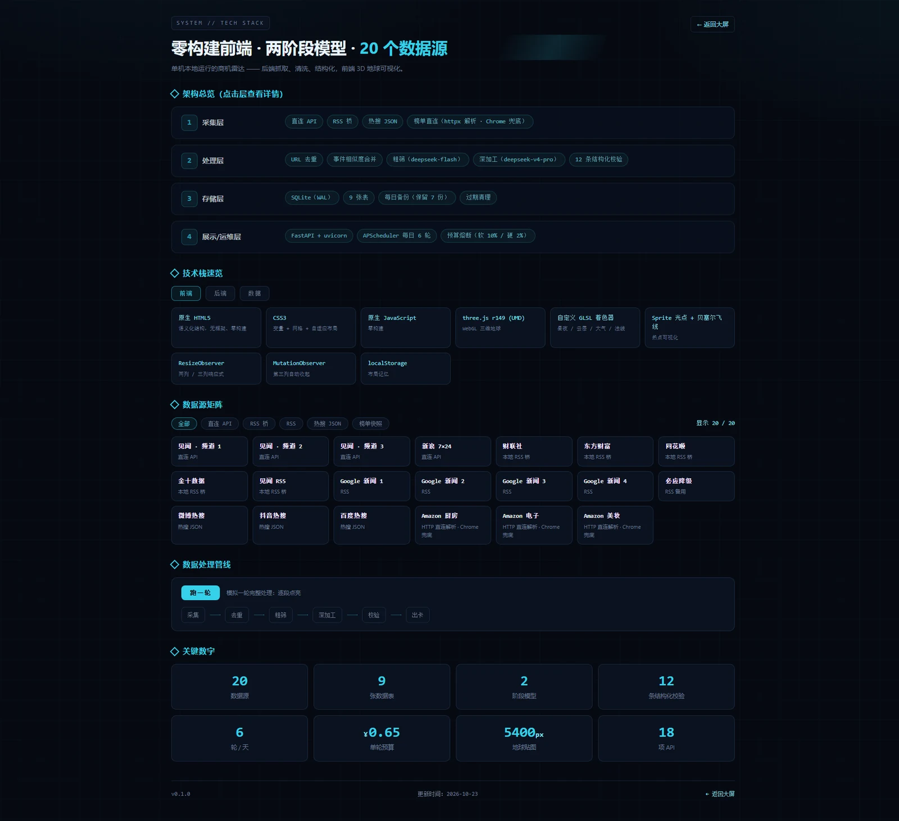

交互态：点开「处理层」+ 管线跑完 6 段（绿色为完成）：

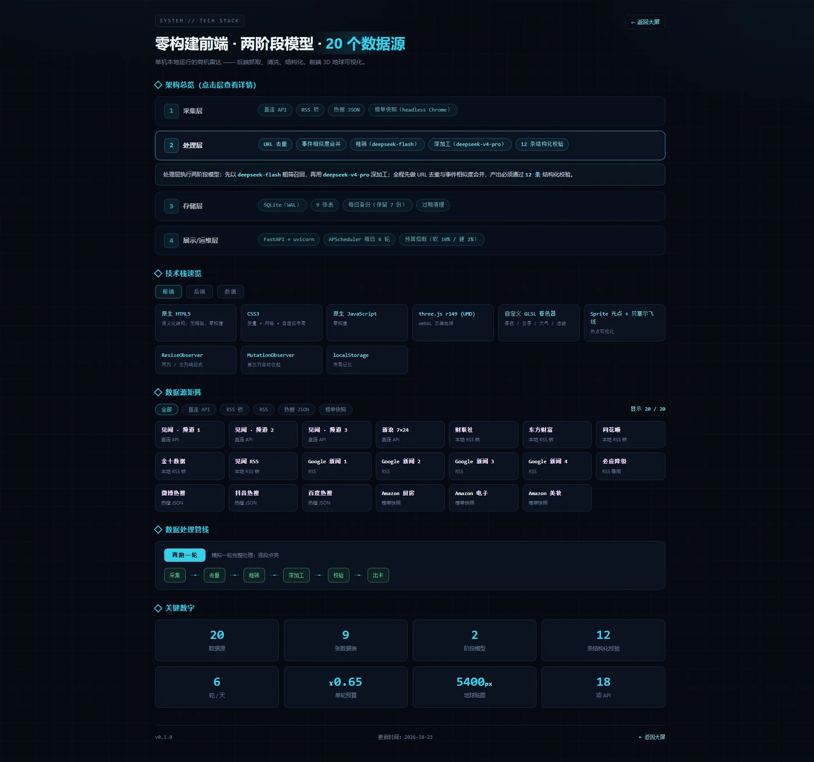

### 大屏（两列 · 白天）

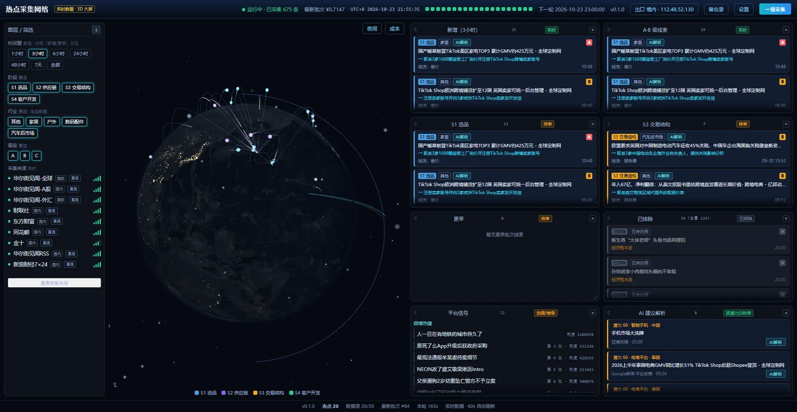

### 大屏（三列 · 宽屏不遮挡地球）

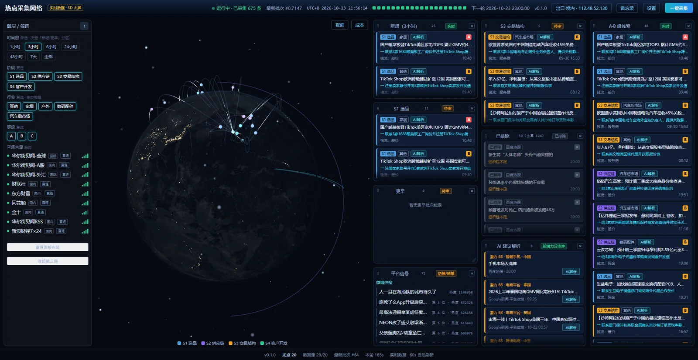

### 大屏（2560×1440 · 三列）

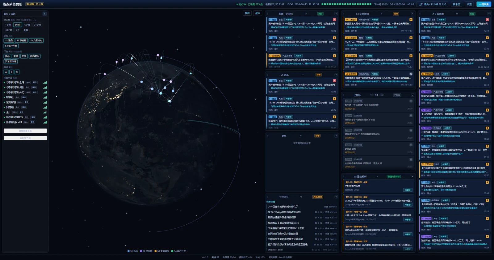

### 夜间模式（黑色镂空地球 + 城市灯光）

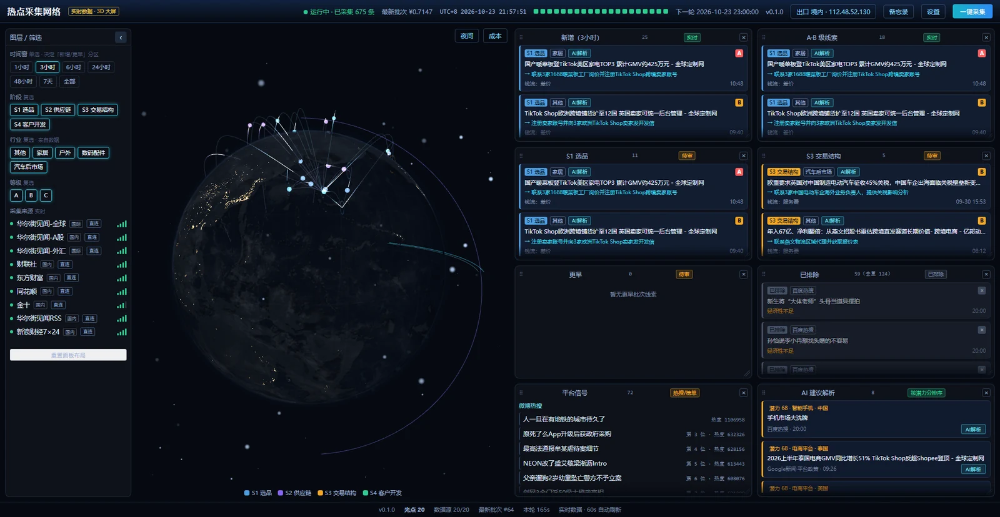

### 地球特写（光点 / 贝塞尔飞线 / 扫描弧）

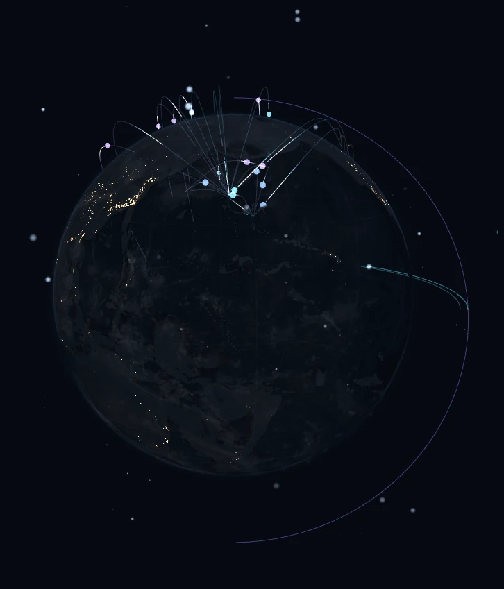

### 平台信号面板（微博 / 抖音 / 百度热搜 + Amazon 榜单）

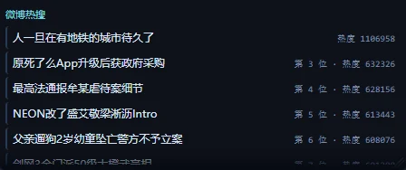

### 采集来源（信号强度图标 · 直连/代理）

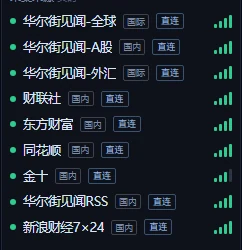

### 抽屉折叠（地球尺寸不变）

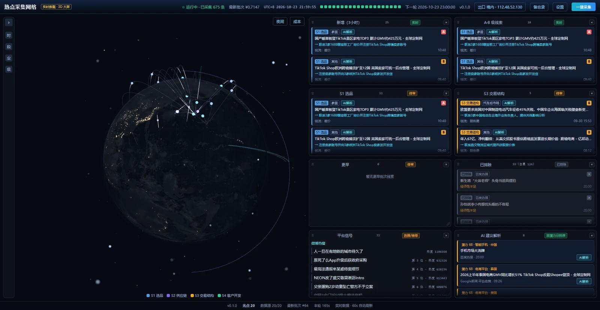

### 设置页（模型 / 预算 / 源体检 / 网络与采集模式）

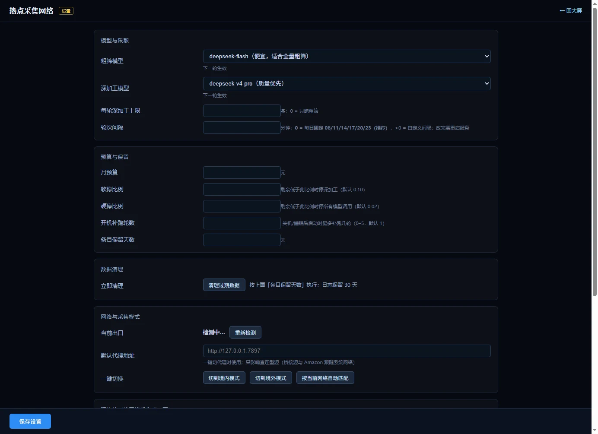

### 成本与预算

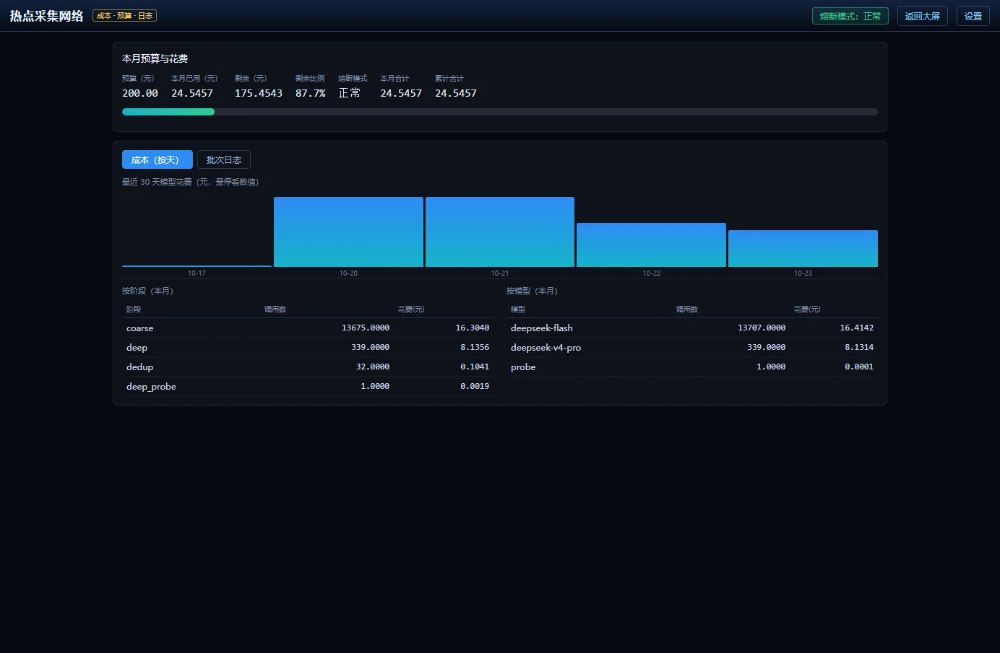

### 备忘录 / 收藏

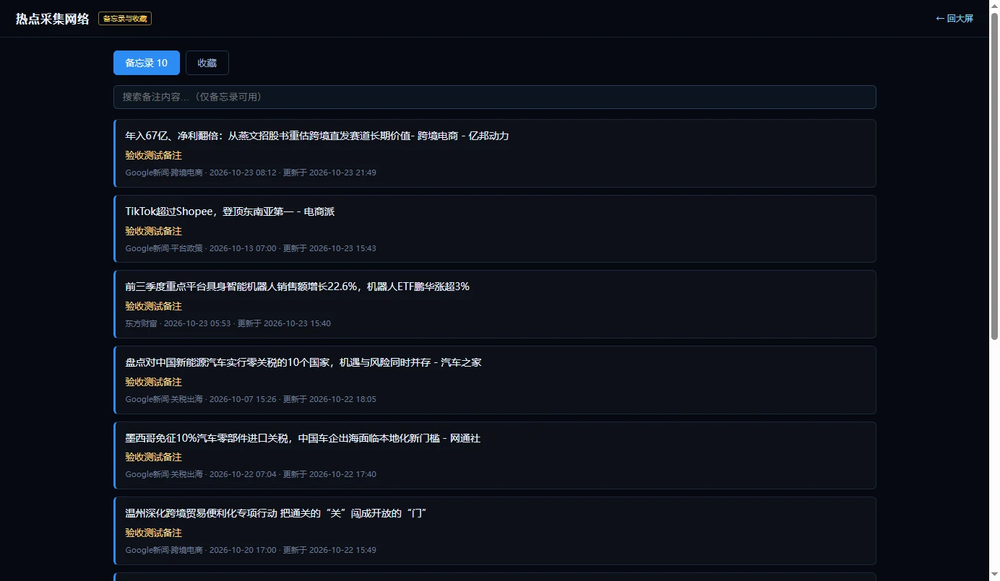

### 条目详情（线索卡 / 校验 / 花费）

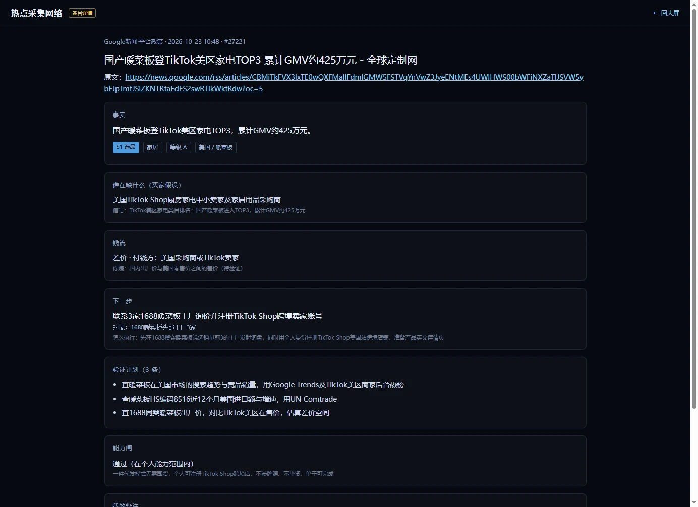

## 数据源一览（v1.2，共 20 个）

| 类型 | 源 | 说明 |
|---|---|---|
| 直连 API | 华尔街见闻全球/A股/外汇、新浪财经7×24 | 走直连，可切代理 |
| 本地桥 | 财联社、东方财富、同花顺、金十、见闻RSS | 由 8053 桥进程抓取 |
| 新闻 RSS | Google新闻 ×5（跨境电商/选品爆款/关税出海/平台政策/海外仓物流） | T12 A 方案；**Google 503 时自动降级必应新闻 RSS** |
| 热搜 | 微博热搜、**抖音热点榜**、**百度热搜** | T12 需求侧信号（抖音/百度为二期，噪音由粗筛过滤） |
| 平台榜单 | Amazon 厨房家居 / 电子配件 / 美妆个护 | T12 C 方案，**日更快照** |

**平台榜单是日更快照**（headless Chrome 抓取，约 1 分钟），不跟 3 小时轮次跑。
手动刷新：

```bash
python run.py --platform-snapshot
```

调度器每天 05:00 自动刷新一次；启动时若快照超过 20 小时也会补刷。

## macOS 运行规则（完整）

本项目是纯 Python + 静态前端，**macOS 可直接运行**，无需改代码。

### 1. 一次性准备

```bash
# 安装 Python 3.11+（推荐 Homebrew）
brew install python@3.12
# 安装 Chrome（平台榜单抓取需要）
brew install --cask google-chrome
```

**从 Windows 迁到 Mac 时注意**：只拷代码 + `data/app.db` + `.env`，**不要拷 `.venv` 和 `data/logs`**
（`.venv` 是平台相关的，拷过去会不可用；旧日志会混进新环境造成误读）。首次运行会自动重建环境。

把项目放到任意目录后，给脚本执行权限（只需一次）：

```bash
chmod +x 启动.command 停止.command
```

### 2. 启动 / 停止

- **双击 `启动.command`**：先选要打开的页面（1 大屏 / 2 设置 / 3 成本 / 4 备忘录 / 5 只启动），
  然后自动建 `.venv`、用清华镜像装依赖、**后台启动**（关掉终端也不影响），等健康检查通过后打开所选页面
- **双击 `停止.command`**：优先按 `data/logs/app.pid` 停，再按端口（9000 / 8053）兜底
- 首次启动后，编辑 `.env` 填入 `DEEPSEEK_API_KEY=sk-...`（可复制 `.env.example`）

```bash
cp .env.example .env
# 然后编辑 .env
```

- **双击 `停止.command`**：按端口结束服务（9000）与 RSS 桥（8053）

### 3. 与 Windows 的差异

| 项 | Windows | macOS |
|---|---|---|
| 启动 | `启动.cmd`（GBK 编码） | `启动.command`（bash） |
| Python | `D:\Software\...\python.exe` | `python3`（venv 内） |
| Chrome 路径 | `C:\Program Files\...` | `/Applications/Google Chrome.app/Contents/MacOS/Google Chrome` |
| 端口占用检查 | `netstat` | `lsof -nP -iTCP:9000` |
| 数据位置 | `data/app.db` | 相同（项目内相对路径） |

> 平台榜单抓取（T12 C 方案）已支持 macOS/Linux 的 Chrome 路径；
> 若没装 Chrome，只影响 3 个 Amazon 榜单源，其余 15 个源照常工作。

### 4. 常见问题（macOS）

- **双击没反应**：在「系统设置 → 隐私与安全性」允许终端/脚本运行，或右键 → 打开
- **`python3` 版本过低**：`brew install python@3.12` 后用 `python3.12 -m venv .venv`
- **端口被占用**：改 `.env` 里的 `PORT=9001` 再启动
- **pip 慢**：脚本已默认用清华镜像

## 四、如何换源（新增 / 停用 / 走代理）

**日常操作（不用改代码）**
- 大屏左侧「采集来源」每行右侧有「直连 / 代理」按钮，点一下即切换，**下一轮生效**。
- 设置页（`/static/settings.html`）可批量勾选启用/停用。

**新增一个数据源（要改代码）**

1. 在 `app/sources/registry.py` 的 `SOURCES` 里加一条 `SourceSpec`：
   - `type="api"`：直连型（参考 `wallstcn.py` / `sina.py`）
   - `type="bridge"`：走本地 RSS 桥（参考 `third_party/china-finance-rss/server.py` 里已有的路由）
2. 直连型还要在 `app/sources/collect.py` 的 `_build_source()` 里分发到你的适配器。
3. 重启服务（`停止.cmd` → `启动.cmd`）。启动时会按 `name` 幂等写入 `sources` 表，
   **不会覆盖你已改过的开关/代理设置**。

> 注意：源必须能直连或能走本地代理；不可达时会在「采集来源」标红并在日志页列进「失败源」。

## 三列（第三侧）行为

- 拖任意面板到页面最右侧投放条 → 展开第三列
- **宽屏 ≥1800px**：三列不覆盖地球，地球区域自适应变窄并左移，地球比例不变
- **窄屏 <1800px**：三列以浮层覆盖地球右侧，地球尺寸保持不变
- 窗口缩放跨 1800px 断点时自动切换（不用刷新）
- 收起：点左侧「收起第三侧」按钮，或把第三列面板全部拖走 → 完整复原两列

## 大屏面板说明

| 面板 | 内容 |
|---|---|
| 新增 / 更早 | 时间窗内外的线索卡（按 S1–S4 阶段着色） |
| A·B 级线索 | 置信度 A/B 的线索 |
| S1 选品 / S3 交易结构 | 按阶段拆分 |
| 已排除 | 被校验拦下或判为非经济的条目（含去重计数） |
| AI 建议解析 | 候选池里按潜力分排序、可手动解析的条目 |
| **平台信号** | 微博/抖音/百度热搜 + Amazon 榜单的原始条目：按来源分组、显示排名/热度，优先展示本轮新增，重复条目垫后，点条目可进详情 |

> 平台信号是「需求侧/注意力」参考，不一定出卡；是否算商机由粗筛与深加工判断。

## 网络与采集模式（换网络后两步搞定）

1. **看出口**：大屏右上角显示「出口 境外 · 203.10.99.42」，设置页「网络与采集模式」显示详细地区
2. **切模式**：
   - 在境内 → 「切到境内模式」（国内源直连、Google/国外走代理）
   - 在境外 → 「切到境外模式」（Google/国外直连、国内走代理）
   - 不确定 → 「按当前网络自动匹配」
3. **体检**：设置页「体检全部源」→ 18/18 就绪；有失败的直连源，点「把失败的直连源切到代理」

> 只影响直连型源（见闻 3 频道 / 新浪 / Google ×5 / 微博）；桥接源与 Amazon 榜单跟随系统网络（代理软件开规则模式即可）。

## 关机 / 换网络 / 异地使用

| 场景 | 行为 |
|---|---|
| 关机 | 不采集；**开机后自动补跑**（默认 1 轮，可在设置页改 0–5 轮，或 `python run.py --catchup 3`） |
| 睡眠 | 唤醒后 2 小时内错过的轮次会自动补跑（`misfire_grace_time=7200`） |
| 异地上网 | 国内源可能变慢/失败（标红不崩），Google/Amazon 更顺；到新网络先点设置页「**体检全部源**」 |
| 换机器 | 拷走 `data/app.db`、`data/config.json`、`data/platform_snapshot.json`、`.env` 即可延续历史 |

> 调度审计（T-003）只统计「服务在线」时刻：关机/睡眠记为「离线跳过」，不算漏轮。

## 代理与国内外采集

代理软件**开「规则模式」**（国内直连、国外走节点）时，本项目 20 个源不用做任何设置即可同时采国内与国外。

细节见 [docs/代理配置指南.md](docs/代理配置指南.md)，要点：
- 「直连/代理」按钮只对**直连型源**生效（见闻 3 频道、新浪、Google 新闻 ×5、微博）
- 桥接型源（财联社/东财/同花顺/金十/见闻RSS）由 8053 桥进程抓取，不吃单源代理设置
- 平台榜单（Amazon）由本机 Chrome 抓取，同样不吃单源设置

## 五、如何改提示词

- 粗筛：`prompts/coarse.md`；深加工：`prompts/deep.md`
- 文件顶部有 `<!-- version: x.y -->`，**每次改动必须递增**，并记一笔到 `docs/prompt-log.md`（改了什么、合格率变化、典型反例）。
- 改完用基准题对比，不要凭感觉：
  ```bash
  python tools/baseline_test.py --set gold
  python tools/baseline_test.py --set live
  ```
  报告输出在 `tools/baseline/report-gold.md` / `report-live.md`。
- **底线**：`app/validate.py` 的 12 条校验（含 r11 能力闸）不要为了让样本通过而放宽。
  校验太严导致大屏没内容时，正确做法是改提示词，不是关校验。

## 六、备份与恢复

- **自动**：每天 03:30 备份到 `data/backups/app-YYYYmmdd-HHMMSS.db`，只保留最近 **7 份**；
  服务启动时若发现超过 24 小时没有备份，会自动补一份。
- **手动备份**：
  ```bash
  python -c "from app.backup import run; print(run())"
  ```
- **恢复**：
  1. `停止.cmd` 停服务
  2. 把 `data/app.db` 改名留底（如 `app.db.before-restore`）
  3. 复制一份备份为 `data/app.db`
  4. `启动.cmd`，打开大屏核对批次与线索数
- 备份使用 SQLite 在线备份 API（WAL 安全），并做 `PRAGMA quick_check` 校验，损坏的备份会被删除。
